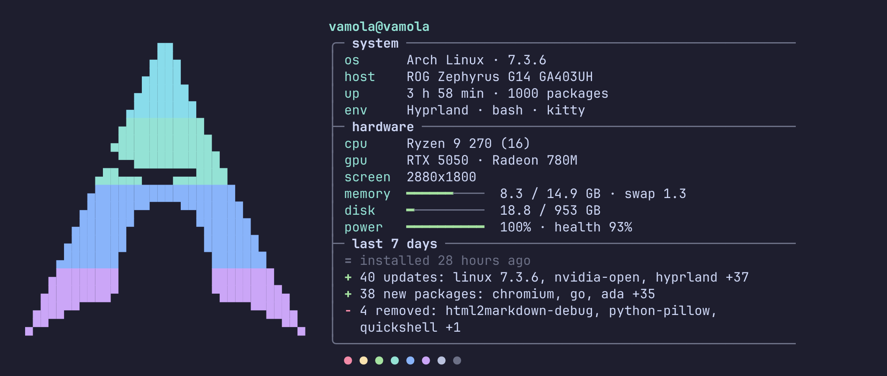

# sincefetch

A system fetch that also tells you **what changed since you last looked**.



neofetch and fastfetch answer "what is this machine?". That answer is the same every time you open a terminal. sincefetch prints it too, and then adds the part that is new:

```
── since 2 days ago ──────────────────────────────────────
 !  restart needed: the running kernel 7.3.5 is no longer on disk
 +  40 packages updated (linux 7.3.5 → 7.3.6, hyprland, firefox +37)
 +  3 new packages: go, vhs, ttyd
 ~  disk / +6.2 GB (41% full)
 !  battery health 94% → 93%
```

## What it looks like

A large logo drawn with half blocks in your terminal's own palette, beside a framed block: the system, the hardware with bars for memory, disk and battery, and what changed.

## What it reports

- **System block:** OS, machine, kernel, uptime, packages, shell, desktop, terminal, displays, CPU, GPUs, memory, swap, disks, battery and battery health.
- **Changes:** packages updated, added, removed or downgraded (from the pacman or dpkg log), a needed restart, kernel change, disk growth and nearly full disks, battery health, reboots, flatpak app count.

## Install

Download a binary from the [latest release](https://github.com/vam0laa/sincefetch/releases/latest) and put it on your `PATH`:

```sh
curl -LO https://github.com/vam0laa/sincefetch/releases/latest/download/sincefetch-linux-amd64.tar.gz
tar -xzf sincefetch-linux-amd64.tar.gz && install -Dm755 sincefetch ~/.local/bin/sincefetch
```

Or build it (Go 1.22 or newer, no dependencies):

```sh
git clone https://github.com/vam0laa/sincefetch && cd sincefetch && make install
```

## Use

```sh
sincefetch                # the system, then what changed since your last look
sincefetch --since 7d     # compare with a week ago (m, h, d, w)
sincefetch --changes      # only what changed
sincefetch --info         # only the system block
sincefetch --json         # for scripts
sincefetch --lang tr      # en or tr, default is the system language
```

To run it in every new fish terminal, add `sincefetch` to the `fish_greeting` function.

## Make it yours

```sh
sincefetch --init     # writes ~/.config/sincefetch/config.json with comments
```

In that file you can:

- choose which lines appear, in which sections and order, and rename them,
- use a built-in logo, none, or **your own ASCII art file**,
- set logo and accent colours (names, 0-255 or `#rrggbb`), the bar characters and the width,
- add your own lines from a fixed text, a file, or a command.

```jsonc
{
  "logo": "~/.config/sincefetch/cat.txt",
  "logo_colors": ["#f5c2e7", "#cba6f7"],
  "sections": [
    { "title": "me", "modules": ["os", "env", "day"] }
  ],
  "custom": {
    "day": { "label": "today", "command": "date +%A" }
  }
}
```

The language follows `--lang`, then `"language"` in the file, then your system locale (`LC_ALL`, `LC_MESSAGES`, `LANG`): Turkish if it starts with `tr`, English otherwise.

## What "since your last look" means

It compares with the newest remembered look that is **at least 12 hours old**, so opening ten terminals in a row does not empty the list. On the first run there is nothing remembered yet, so it reads the last 7 days from the package log. A system installed inside that window is reported as such instead of listing every package as new.

## Privacy and safety

- Reads `/proc`, `/sys`, `/etc/os-release`, the package database and the package log.
- Writes one file: `~/.local/state/sincefetch/history.json` (at most one entry an hour, kept for 90 days). `--no-save` writes nothing.
- No root and no network of its own. It runs another program only if you put a `command` line in your settings file (through `sh`, cut off after one second).

## Limits

- Package changes need pacman (Arch and relatives) or dpkg (Debian and relatives). Elsewhere only the other changes are shown.
- Tested on one Arch + Hyprland laptop. The Debian parsing is covered by unit tests only.
- Display refresh rate is not shown.

---

## Türkçe

Klasik sistem bilgilerinin yanında **son bakışından beri neyin değiştiğini** söyleyen bir fetch aracı: güncellenen paketler, gereken yeniden başlatma, disk büyümesi, pil sağlığı. Root istemez, ağa çıkmaz, yalnızca kendi anlık görüntü dosyasını yazar. Kurulum: `make install`.

MIT License.
